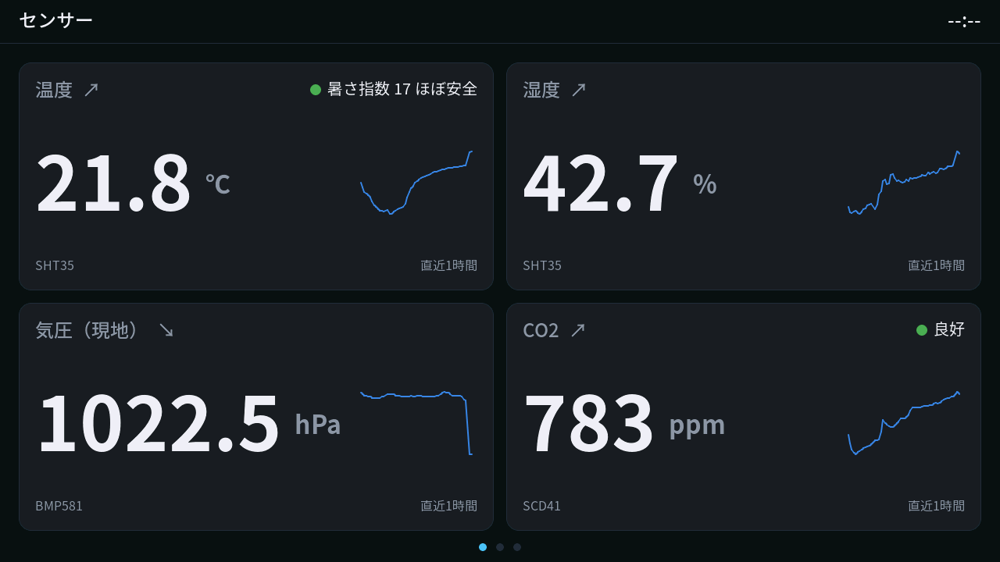
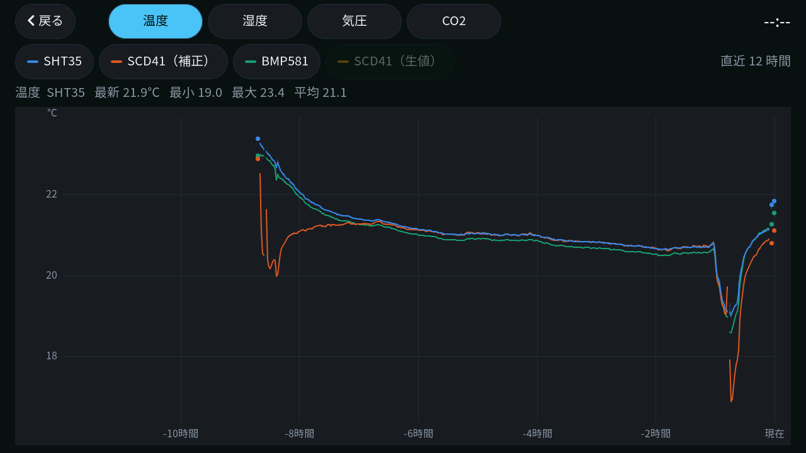
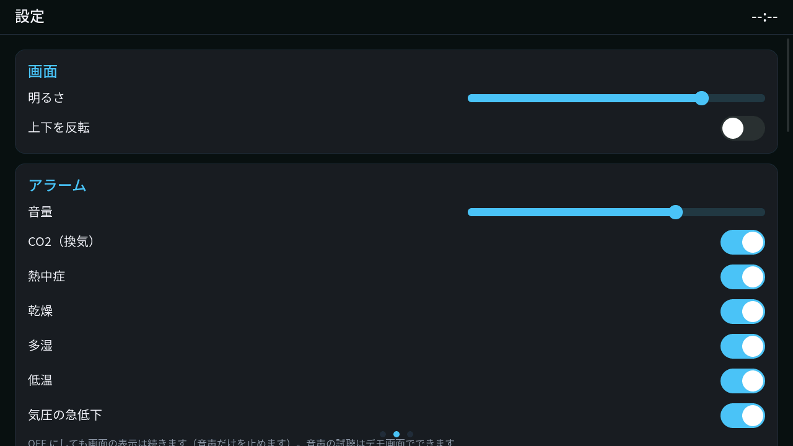
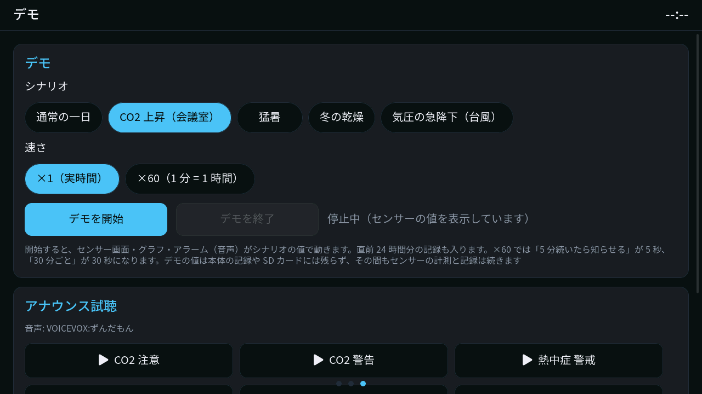

# Tab5 環境モニター

M5Stack Tab5 に自作のセンサー基板をつないで、部屋の **CO2・温度・湿度・気圧** を大きな画面に表示する据え置き型のモニターです。24 時間分を記録してグラフで見られ、換気が必要なときや熱中症の危険があるときは音声（ずんだもん）で知らせます。



| グラフ（直近 12 時間） | 設定 |
|---|---|
|  |  |

## できること

- **4 項目を同時に表示**: 温度・湿度（SHT35）、気圧（BMP581）、CO2（SCD41）。各カードに直近 1 時間のミニグラフと変化の矢印、暑さ指数（WBGT）と CO2 の状態（良好 / 注意 / 警告）
- **グラフ**: カードをタップすると直近 12 時間のグラフ。センサーごとの値を重ねて比べられ、長押しで時刻と値を読み取れます
- **音声アラーム**: CO2 の上昇、熱中症（暑さ指数）、乾燥・多湿、低温、気圧の急低下を声と画面の帯で通知。種類ごとに ON/OFF と音量を設定できます
- **記録**: 1 分ごとの値を本体のフラッシュに保存（約 3.7 日分、停電しても直近 24 時間を復元）。microSD を挿すと 1 日 1 ファイルの CSV に書き出します
- **デモ**: センサーがなくても「CO2 上昇（会議室）」「猛暑」「冬の乾燥」などのシナリオで画面とアラームを試せます（×60 の早送りあり）。センサー基板が見つからないときは模擬センサーで動きます



## ハードウェア

| 部品 | 内容 |
|---|---|
| 本体 | M5Stack Tab5（ESP32-P4、5 インチ 1280×720 を横向きで使用） |
| センサー基板（自作） | SCD41（CO2）/ SHT35（温度・湿度）/ BMP581（気圧）。I2C、3.3V、Qwiic コネクタ |
| 接続 | Tab5 の PORT.A（Grove, 5V）→ 3.3V レギュレーターを載せた変換アダプタ → Qwiic ケーブル → センサー基板 |

接続とセンサーの設定は [docs/SPEC.md](docs/SPEC.md) の「1. ハードウェア」にあります。

センサー基板と変換基板の製造データ（JLCPCB 用のガーバー・BOM・部品の位置ファイル）と OSHWLab のリンクは [hardware/](hardware/README.md) にあります。自分で作りたい人はこちらを見てください。

> [!WARNING]
> PORT.A の 5V をセンサー基板に直接つながないでください。BMP581 などの定格（3.3V）を超えます。

## ビルドと書き込み

[ESP-IDF v5.5](https://docs.espressif.com/projects/esp-idf/en/v5.5/esp32p4/get-started/) を用意してから:

```sh
idf.py set-target esp32p4   # 初回のみ
idf.py build flash monitor
```

依存コンポーネント（LVGL、Tab5 BSP など）は `idf_component.yml` から自動で取得されます。

起動後、時刻は設定画面から手動で合わせます（Wi-Fi は使いません）。

### ホストでの単体テスト

センサー値の処理・記録・アラーム判定（`components/core`）は Mac / Linux 上でテストできます。

```sh
tools/run_host_tests.sh
```

### 開発用ツール

| スクリプト | 用途 |
|---|---|
| `tools/ui_remote.py` | USB シリアル経由で画面のスクリーンショットを撮る・タップやスワイプを送る（`CONFIG_UI_DEBUG_CONSOLE`） |
| `tools/fetch_fonts.sh` / `tools/gen_fonts.py` | Noto Sans JP を取得し、UI で使っている文字だけの LVGL フォントを生成 |
| `tools/gen_voice.py` | VOICEVOX（ローカルで起動したエンジン）でアラーム音声を生成 |

## ディレクトリ構成

```
main/                起動処理
components/
  board/             Tab5 の初期化（電源・I2C・RTC など）
  display/           表示（ティアリングを防ぐ PPA 回転とトリプルバッファ）
  sensors/           SCD41 / SHT35 / BMP581 の読み取りと模擬センサー
  core/              補正・平滑化・派生指標・アラーム判定・記録形式（ホストでテスト可能）
  datastore/         フラッシュへの 1 分値の記録
  sdlog/             microSD への CSV 書き出し
  audio/             音声の再生
  settings/          設定の保存
  controller/        センサー・アラーム・音声・画面の明るさのつなぎ込み
  ui/                画面（センサー・グラフ・設定・デモ）
docs/SPEC.md         仕様書（ハードウェア・画面・記録・アラームの詳細）
hardware/            基板の製造データ（センサー基板・変換基板）
```

## クレジット

- 音声: VOICEVOX:ずんだもん
- フォント: [Noto Sans JP](https://github.com/notofonts/noto-cjk)（SIL Open Font License 1.1、[assets/fonts/src/OFL.txt](assets/fonts/src/OFL.txt)）、LVGL 内蔵の Montserrat
- [LVGL](https://lvgl.io/)（MIT）、[ESP-IDF](https://github.com/espressif/esp-idf)（Apache-2.0）

## ライセンス

[MIT License](LICENSE)（© 2026 yuna）。ただし次のものはそれぞれのライセンス・規約に従います。

- `assets/voice/` の音声: VOICEVOX および ずんだもんの利用規約
- `components/ui/fonts/` のフォントデータ（Noto Sans JP から生成）: SIL Open Font License 1.1
